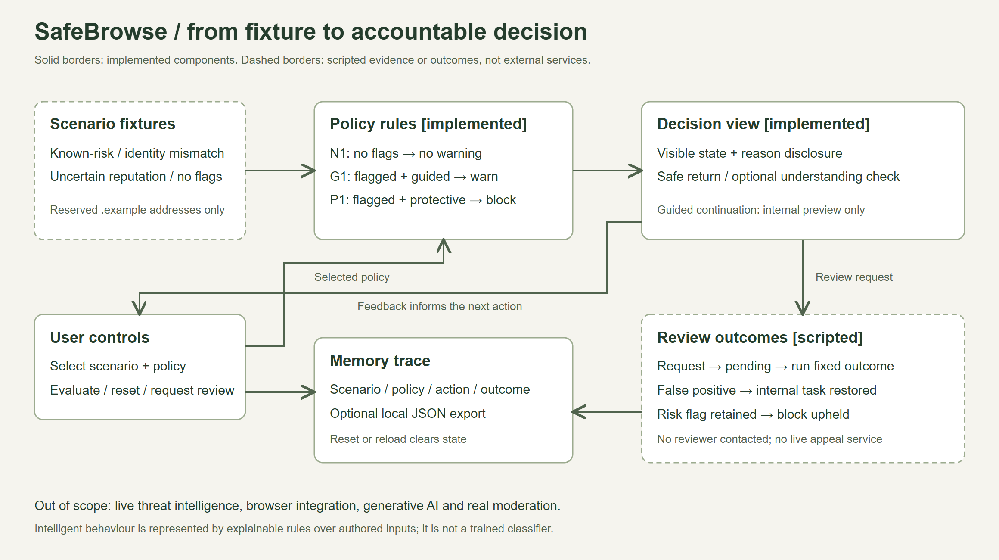
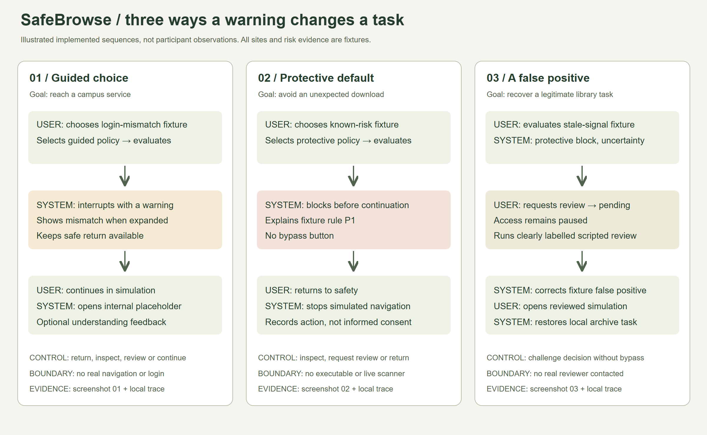
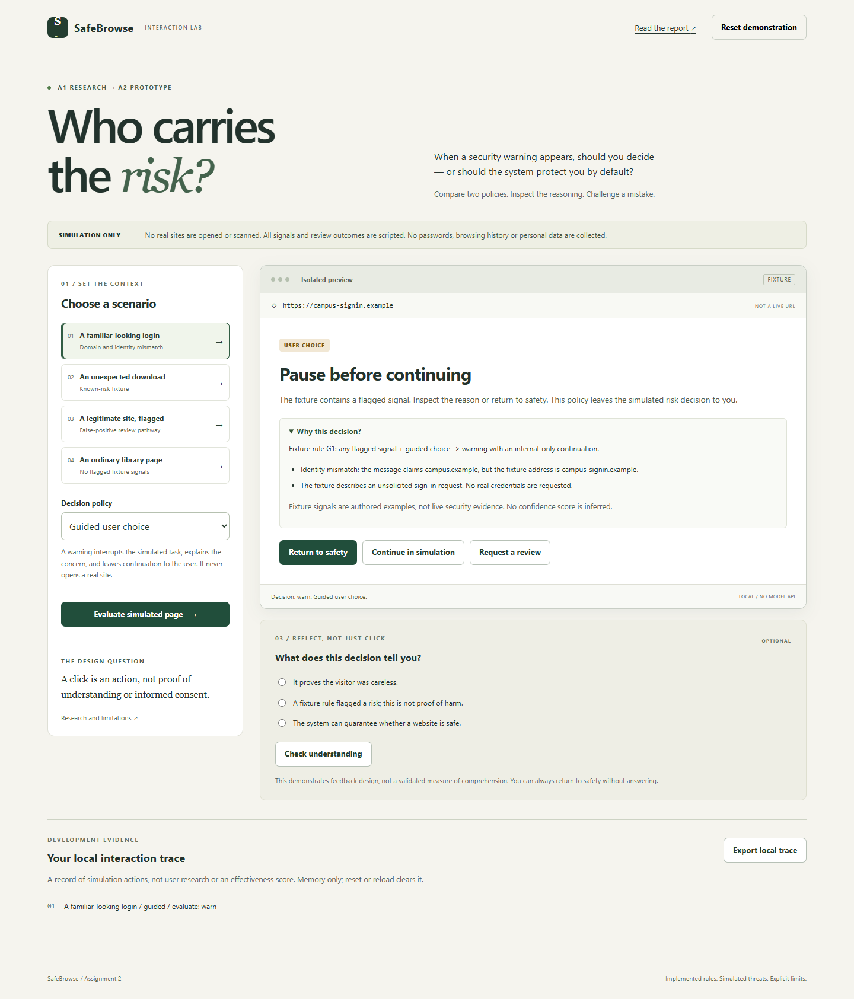

# SafeBrowse: Who Carries the Risk?

Assignment 2: Project Report

**Abstract: 175 words | Main report: 946 words | Combined: 1121 words**

## Abstract

SafeBrowse is an interactive prototype exploring who should make a risk decision when a browser raises a security warning. It develops the argument from my Assignment 1: a warning should not be judged solely by whether someone obeys it, and clicking through should not automatically be treated as informed consent.

The prototype compares guided user choice with a protective default across four authored scenarios. It explains the signal and rule behind each decision, offers a safe return, and demonstrates recourse when a legitimate site is wrongly flagged. An optional explanation question shows how feedback might address misunderstanding without preventing users from leaving.

The interface, decision rules, state transitions and local interaction trace are implemented. Threat signals, websites and review outcomes are simulated. No live websites are visited, no trained model is used, and no credentials or browsing history are collected. Automated browser checks provide implementation evidence, not evidence that either policy improves real security or user understanding. The contribution is a bounded, inspectable interaction demonstrating the trade-off between protection, user control and recovery from error.

## 1. Problem, evidence and scope

My A1, *Who Should get the Risk? Browser Security Warnings and User Responsibility*, questioned whether security interfaces transfer technical responsibility unfairly to users. SafeBrowse turns that question into a comparison users can operate, rather than a claim that more alarming warnings solve the problem.

Egelman, Cranor and Hong (2008) found active phishing warnings more effective than the passive warning they tested. This supports interrupting a risky simulated task, not making every notification equally prominent. Sunshine et al. (2009) highlight the costs of ineffective SSL warnings and unnecessary interruptions. Akhawe and Felt (2013) show that behaviour varies across warning types and browser interfaces. Their telemetry records actions, but cannot by itself establish the reasons behind each action.

These findings motivate inspectable decisions and recourse. They do not validate this prototype's rules. A brief wellbeing concept was replaced after revisiting A1: browser warnings provide a stronger evidence-to-design connection. No lecturer feedback or participant findings are claimed.

The studies concern older browser designs, so I use them to frame tensions, not to predict current users' behaviour. The comparison also holds the fixture constant: comparing a dangerous page under one policy with a harmless page under another would confuse policy effects with scenario differences. Four fixtures make that distinction inspectable, while keeping the implementation small enough to explain. The legitimate-site fixture is intentionally not an exceptional hidden case; it is a visible reminder that protection can obstruct a reasonable task.

## 2. Design choices and trade-offs

**Responsibility and defaults.** Protective mode blocks every flagged fixture without a bypass. Guided mode interrupts with an explanation but permits internal-only continuation. Changing only the policy on the same scenario makes responsibility allocation visible. Both modes allow unflagged fixtures without warning, reflecting the concern about unnecessary interruptions in Sunshine et al. (2009). Protective mode deliberately also blocks an uncertain fixture: its recoverable false positive exposes the cost of conservative defaults rather than hiding it.

**Visibility and feedback.** Each result names the decision, and an expandable explanation identifies the fixture signal and fired rule. For example, an identity mismatch under protective mode produces rule P1 and a block. This lets users inspect what happened instead of accepting an unexplained verdict. Progressive disclosure keeps the initial choice concise while retaining detail. A persistent status line distinguishes an evaluated decision, pending review and internal preview. Text labels accompany colour so colour alone does not communicate risk.

**Control and recovery.** Returning to safety never requires a questionnaire. For a blocked fixture, requesting review leaves access paused; it does not silently reverse the decision. A separate, explicitly scripted review corrects the stale reputation entry in the legitimate-site scenario, enabling an internal archive preview. The known-risk scenario instead retains its block. This implements the transparency-and-recourse argument in A1 while acknowledging that a real review service would require independent evidence, governance and response times.

**Understanding, not compliance alone.** An optional question asks what the decision establishes. Incorrect answers receive an explanation; the correct answer distinguishes a fixture-based concern from proof of harm. The question is deliberately not a test users must pass to escape a warning. A correct selection could be guessed or learned from the wording, so it is not a validated comprehension measure. Likewise, returning to safety is not labelled informed consent or successful risk understanding.

**Predictability and accessibility.** Explicitly labelled controls, visible keyboard focus, native buttons, a select and radio inputs support predictable operation. Scenario buttons expose selection through `aria-pressed`. Focus moves to the result after evaluation and to review status after review actions. Responsive layouts retain the same decisions at narrow widths. Automated keyboard and overflow checks are useful but do not establish accessibility conformance or replace testing with assistive-technology users.

## 3. Architecture and illustrated interaction

The system diagram separates implemented software from simulated evidence. Authored signals and the selected policy enter a deterministic rule function: no flags means no warning; flagged guided mode means warning; flagged protective mode means block. JavaScript renders the resulting controls. Intelligence is represented by explicit conditional rules, not a trained classifier, live reputation service or generative model. This limits realism but makes decisions reproducible.

The storyboard follows three complete paths. First, a login mismatch in guided mode produces a warning; the user inspects it and opens an internal placeholder. Second, a known-risk download in protective mode is blocked, and the user returns to safety. Third, an uncertain library fixture is blocked, reviewed and corrected before the legitimate task resumes. All navigation remains inside the demonstration.

An in-memory trace records scenario, policy, action and outcome for inspection. Export creates a local JSON file only when requested. Reset or reload clears state. No personal text fields, persistent storage, model APIs or analytics are used.

## 4. Development checks and limitations

Implementation checks cover both policies, unflagged access, review pending and corrected states, upheld blocks, optional answer feedback, safe return, reset and trace export. Keyboard operation and layout overflow are checked at 390 and 320 pixels. Twelve automated tests passed; screenshots show actual rendered states. These checks demonstrate software behaviour, not participant experience, reduced warning fatigue or security effectiveness.

The architecture uses fixed signals without probabilities because invented confidence scores would imply unsupported accuracy. Further work should compare matched tasks with participants of varied digital experience, measuring explanations, perceived control and legitimate-task completion alongside decisions. Scenario order would need counterbalancing, and longer-term warning fatigue would require a different study. Real threat detection, browser integration and genuine review remain outside this submission.

## 5. Repository and development record

The [public repository](https://github.com/thisispossiable/quiet-space-a2) contains the implementation, tests, figures and [README development record](https://github.com/thisispossiable/quiet-space-a2/blob/a2-safebrowse-v1.2/README.md). Submitted version: [a2-safebrowse-v1.2](https://github.com/thisispossiable/quiet-space-a2/tree/a2-safebrowse-v1.2). Assessors can inspect the repository without signing in. The README identifies AI assistance and distinguishes agent checks from student review.

## References

Akhawe, D. and Felt, A.P. (2013) 'Alice in Warningland: A Large-Scale Field Study of Browser Security Warning Effectiveness', *22nd USENIX Security Symposium*, pp. 257-272. Available at: https://www.usenix.org/conference/usenixsecurity13/technical-sessions/presentation/akhawe

Egelman, S., Cranor, L.F. and Hong, J. (2008) 'You've Been Warned: An Empirical Study of the Effectiveness of Web Browser Phishing Warnings', *Proceedings of CHI '08*, pp. 1065-1074. https://doi.org/10.1145/1357054.1357219

Sunshine, J., Egelman, S., Almuhimedi, H., Atri, N. and Cranor, L.F. (2009) 'Crying Wolf: An Empirical Study of SSL Warning Effectiveness', *18th USENIX Security Symposium*. Available at: https://www.usenix.org/conference/usenixsecurity09/technical-sessions/presentation/crying-wolf-empirical-study-ssl-warning

Reused material: the research question, critical synthesis and three references are developed from my A1. Figures and fixtures were created for A2 with AI assistance; they do not reproduce the studies' original warning interfaces. AI assistance is disclosed in the README.
